# HyDAMO validatie Webclient

De Webclient is de visuele schil van de Validatietool en geeft de gebruiker de mogelijkheid om de API graphisch te besturen. Hiermee kan je validatietaken aanmaken, datasets en validatieregels toevoegen, een taak starten en de resultaten downloaden. Bovendien geeft de Webclient de mogelijkheid om invoerbestanden en rekenresultaten op de kaart of als tabel te bekijken.

Hieronder is een stap-voor-stap toelichting hoe je met de Webclient aan de slag gaat:

## 1. Starten en inloggen

Je bereikt de Webclient onder de volgende URL: [https://validatietool.hydamo.nl/](https://validatietool.hydamo.nl/){ target="_blank" }

De Webclient start met een inlogscherm. Om van de Webclient gebruik te kunnen maken is het nodig om een [gebruikersaccount](02%20Gebruikersregistratie.md) te hebben.

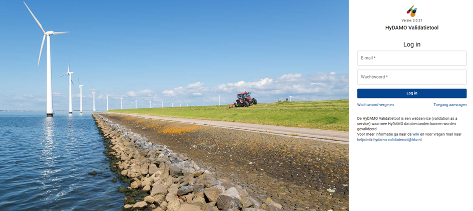

Voer je gebruikersnaam/emailadres in en daarna het wachtwoord. Klik op de knop 'Log in' om toegang te krijgen.

Als je geen gebruikersnaam of wachtwoord hebt, klik dan op de link'Toegang vragen'. Volg de instructies voor het aanvragen van een gebruikersaccount, door een email te versturen naar [hydamo-validatietool@hetwaterschapshuis.nl](mailto:hydamo-validatietool@hetwaterschapshuis.nl), met daarin uw voornaam, achternaam, emailadres, mobiele telefoonnummer en de naam van uw organisatie.

## 2. De opbouw van de schermen

Het scherm van de Webclient bestaat uit 3 delen:

- Een verticale menu-balk.
- Verschillende werkruimtes waarin validatietaken beheerd kunnen worden en resultaten bekeken kunnen worden.
- Een paneel met filteropties en/of instellingen van achtergrondkaarten (afhankelijk van het gekozen scherm in de menu-balk).

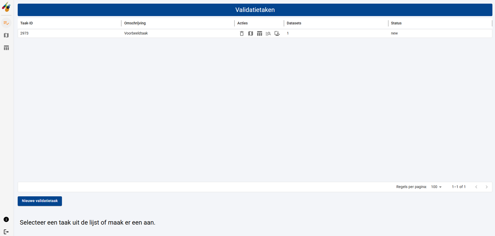

### De Menu-balk

De verticale menu-balk bevat 3 items:

 Werkruimte beheren: een item om de werkruimte voor het definiëren van validatietaken te activeren.

Taak viusaliseren op kaart: een item om de werkruimte voor het visualiseren van validatie resultaten in een kaart te activeren.

Taak viusaliseren als tabel: een item om de werkruimte voor het visualiseren van validatie resultaten in een tabel te activeren.

De laatste twee menu-items worden pas actief als er een validatietaak met resultaten beschikbaar is in de tabel met validatie-taken!

### De Werkruimte

Er worden 3 soorten werkruimten onderscheiden in de Webclient:

- De werkruimte voor het beheren van validatie-taken.

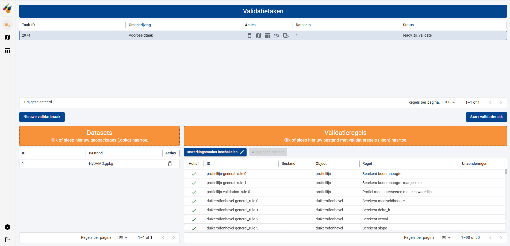

- De werkruimte voor het bekijken van validatie resultaten op een kaart.

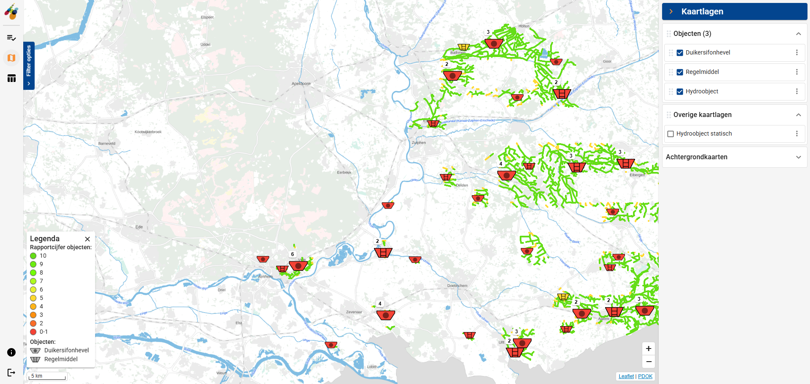

- De werkruimte voor het bekijken van validatie resultaten in een tabel.

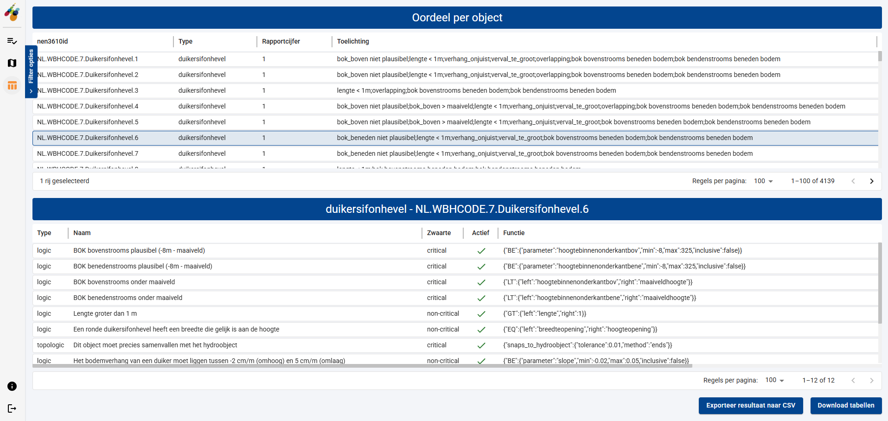

### Het Kaart- en Tabel-zijpaneel met filteropties

Aan de linkerzijde van de kaart en resultaattabel is een inklapbaar paneel met filteropties. Alleen de kaart heeft bovendien aan de rechterzijde een inklapbaar paneel voor het aan- en uitzetten van kaartlagen.

|  **Paneel met filteropties**                                                             |  **Paneel met kaart**  **opties**                                                        |
|:-----------------------------------------------------------------------------------------|:-----------------------------------------------------------------------------------------|
| 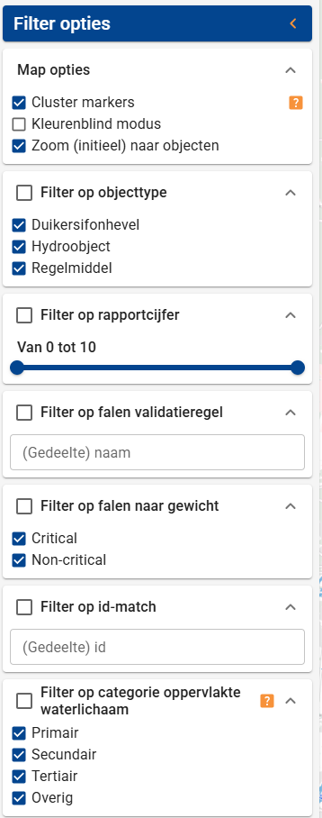{ width="180" } | 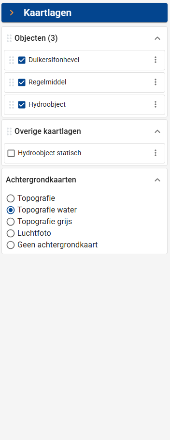{ width="180" } |

## 3. Beheren van validatietaken

In deze werkruimte beheer je je validatietaken in een tabel. Wanneer je een validatietaak selecteerd kunnen in de ondere helft van het scherm GeoPackage-invoerdatasets en het JSON-bestand met validatieregels toegevoegd worden.

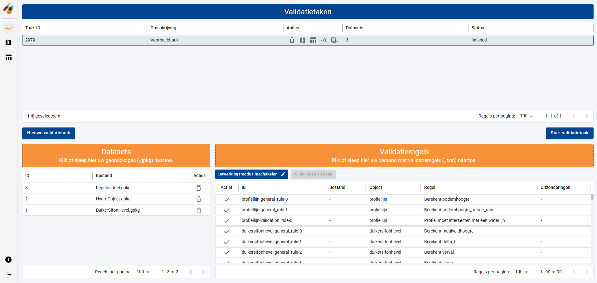

## 4. Een nieuwe validatietaak aanmaken

Voordat de tool kan rekenen moet eerst een validatietaak gedefinieerd worden. Ga naar de werkruimte van het validatietaken-beheer en maak een nieuwe validatietaak aan door op de knop ‘nieuwe validatietaak’ te klikken. Er verschijnt een dialoog, waarin je een willekeurige omschrijving kan opgegeven.

{width="400"}

De validatietaak wordt geinitialiseerd en verschijnt in de beheertabel. Er wordt automatisch een uniek ‘id' toegewezen en de nieuwe taak krijgt standaard de status 'new’.

In de tabel vind je verder een kolom ‘Datasets'. Hierin kun je zien of en hoeveel dataset-bestanden je aan een validatietaak hebt toegevoegd. Tot slot is er een kolom 'Acties’ zichtbaar met een vijftal knoppen:

 Taak verwijderen: ‘Verwijder deze taak’, waarmee u de validatietaak (inclusief eventuele resultaten definitief verwijderd) uit uw lijst met validatietaken. Taken met een validatieresultaat ouder dan 10 dagen worden door het systeem automatisch verwijderd!

Taak viusaliseren op kaart: ‘Bekijk resultaten van deze taak op de kaart’, waarmee u de werkruimte voor het bekijken van validatie resultaten op de kaart activeert.

Taak viusaliseren als tabel: ‘Bekijk de resultaten deze taak in tabelvorm’, waarmee u de werkruimte voor het bekijken van validatie resultaten in een tabel activeert.

Metadata: ‘Bekijk de meta-informatie van deze taak’, waarmee u metadata van een uitgevoerd validatietaak kunt opvragen.

Download resultaten: ‘Bekijk de meta-informatie van deze taak’, waarmee u metadata van een uitgevoerd validatietaak kunt opvragen.

## 5. Invoer-datasets toevoegen aan een taak

De HyDAMO-datasets kunnen afkomstig zijn van registers van Waterschappen, uit het GKW (GegevensKnooppunt Waterschappen) of uit het NHI portaal. Datasets die je gebruikt in de HyDAMO Validatiemodule moeten in het (open data) formaat Geopackage aangeboden worden. Verder moet de data voldoen aan het [HyDAMO-datamodel](https://github.com/HetWaterschapshuis/HyDAMOValidatiehandboek/tree/main/validation_schemas/datamodellen_hydamo){:target="_blank"}.

Om een dataset toe te voegen selecteer je eerst een validatietaak in de tabel met validatietaken. Je kan op twee manieren een dataset toevoegen aan de geselecteerde validatietaak:

1. Klik ergens in het oranje vlak van de ‘Datasets’. Er wordt een bestandsdialoog geopend waarin je een Geopackage databestand kan selecteren.
2. Selecteer een Geopackage databestand in verkenner en sleep deze op het oranje vlak van de ‘Datasets’.

Zodra de databestanden zijn toegevoegd verschijnen deze in de tabel met datasets.

{width="500"}

Merk op dat na het toevoegen van 1 of meerdere dataset bestanden, het aantal datasets in de tabel met validatietaken wordt bijgewerkt. De status van de validatietaak is na het toevoegen van datasets nog ongewijzigd. Pas als er zowel datasets als validatieregels aan een validatietaak zijn toegevoegd zal de status gewijzigd worden.

Nieuw is de mogelijkheid om de ingelezen data (voordat een validatietaak is gestart) alvast te beoordelen op de kaart. Activeer hiervoor de menuknop ‘Validatieresultaten op kaart’ in de verticale menu-balk of de knop ‘Bekijk resultaten van deze taak op de kaart' in de kolom 'Acties’ van de betreffende taak in de tabel met validatietaken.

De legenda duidt de verschillende iconen (afhankelijk van de beschikbare objecten in de databestanden). Hydro-objecten (oftewel watergangen) worden als lijnen weergegeven en zijn op genomen in de legenda. De kleuren uit de legenda zijn pas van toepassing als een validatieresultaat beschikbaar is.

Het paneel met de kaartopties (rechterzijde van het scherm) bevat voor elk type object uit de databestanden een aparte kaartlaag. Je kan elke kaartlaag in de kaart uitzetten door het vinkje weg te halen. Daarnaast is er een sectie met 'Overige kaartlagen'. Hier wordt altijd een referentie-kaartlaag van de watergangen getoond en eventuele andere objecten waarvan geen geografische ligging bekend is. Tot slot is er een sectie waarin je van achtergrondkaartlaag kan wisselen.

Het paneel met de filteropties (linkerzijde van het scherm) bevat allerlei filter-mogelijkheden. Een groot deel van deze filteropties is op basis van validatieresultaten en dus alleen relevant als de validatietaak al is uitgevoerd.

## 6. Validatieregels toevoegen aan een taak

Bij iedere validatie horen validatieregels die aangeven op welke aspecten gecontroleerd moet worden. Er zijn intrinzieke syntaxvalidatie-regels op basis van het [HyDAMO-datamodel](https://github.com/HetWaterschapshuis/HyDAMOValidatiehandboek/tree/main/validation_schemas/datamodellen_hydamo){:target="_blank"} en [inhoudelijke validatieregels](../Introductie%20tool/02%20Validatieregels). De inhoudelijke validatieregels moet je als gebruiker zelf per validatietaak als JSON-bestand toevoegen. Je kan een JSON-regelbestand aanpassen en controleren aan de hand van een [Json schema](TO DO AANPASSEN https://github.com/HetWaterschapshuis/HyDAMOValidatieregels/blob/main/schemas/rules_0.9.0.json). Gebruik hiervoor eventueel een online tool zoals [jsonschemavalidator](https://www.jsonschemavalidator.net/).

Voeg een JSON-regelbestand toe door eerst een validatietaak in de taakbeheertabel te selecteren. Ja kan op twee manieren een bestand met validatieregels toevoegen aan de taak:

1. Klik ergens in het oranje vlak van de ‘Validatieregels’. Er wordt een bestandsdialoog geopend waarin je het regelbestand kan selecteren.
2. Selecteer het regelbestand in de verkenner en sleep deze op het oranje vlak van de ‘Validatieregels’.

Zodra het bestand is toegevoegd wordt de tabel met validatieregels gevuld. Deze tabel bevat de volgende kolommen (van links naar rechts):

- De status van validatieregel (vinkje als de regel actief is en een kruisje als de regel inactief is).
- De naam van het bestand waaruit de validatieregel is gelezen.
- Op welk DAMO object de validatieregel van toepassing is.
- De omschrijving van de validatieregel.
- Of voor de validatieregel uitzonderingen (objecten die uitgesloten worden van validatie met deze validatieregel) zijn gedefinieerd.

Als je een verkeerd regelbestand hebt toegevoegd moet je een nieuw bestand toevoegen om de oude te overschrijven. Het is niet mogelijk om validatieregels te verwijderen. Het is wel mogelijk om een ingelezen validatieregel te deactiveren. Klik hiervoor op de knop ‘Bewerkingsmodus inschakelen'. In de kolom ‘Actief’ is het nu mogelijk om vinkjes te verwijderen of te plaatsen. Dit kan alleen bij validatieregels en niet bij de algemene rekenregels ('general rules’). Na het aanpassen kan je instellingen opslaan door de knop 'Wijzigingen opslaan'. De HyDAMO Webclient bewaard de instellingen ook als je opnieuw laadt.

Merk op dat na het toevoegen van validatieregels aan een validatietaak (in het geval dat er minimaal 1 dataset bestand aanwezig is), de status van de validatietaak wordt aangepast in 'ready\_to\_validate'.

## 7. Een validatietaak starten

Een validatie kan pas gestart worden als de status van een taak in de taaktabel staat op 'ready_to_validate'. Hiervoor is het nodig dat je minimaal 1 dataset-bestand en 1 validatieregel hebt toegevoegd. De knop 'Start validatietaak’, onderin het scherm van de werkruimte takenbeheer, is dan actief en kan gedrukt worden.

Als je ‘Start validatietaak' drukt verandert de status van de geselecteerde taak naar ‘pending’. Afhankelijk van de beschikbare capaciteit in de online rekenomgeving (er kunnen maximaal 3 validatietaken simultaan uitgevoerd worden) wordt de validatietaak meteen opgestart of wordt de validatie-taak in een wachtrij geplaatst. De wijzigt dan wijzigen naar ‘validating’.

De validatietaak is klaar als de status van ‘validating' wijzigt in ‘finished’. De validatietaak is dan zonder foutmelding tot een goed einde gekomen. Als 'error’ getoond wordt is de validatie is voortijdig gestopt door een fout.

## 8. De validatielog uitlezen

Als de status van een validatietaak ‘finished' of ‘error’ toont is het uitvoeren van de validatietaak beeindigd. Bekijk in beide gevallen eerst de metadata van de validatie-taak. Klik op icoon  in de rij van de betreffende taak (in de kolom 'Acties’). Er verschijnt een popup venster met daarin informatie over de validatie.

De volgende informatie wordt in de metadata getoond (van boven naar beneden):

- **task_id**: de id van de validatietaak waarvoor metadata is opgevraagd.
- **api-version**: de versie van de HyDAMO Validatietool API die is gebruikt.
- **user_name**: je eigen gebruikersnaam.
- **task_started**: datum en tijd waarop de validatietaak is gestart.
- **task_finished**: datum en tijd waarop de validatietaak is geëindigd.
- **success**: indicator of de validatietaak succesvol is uitgevoerd ('true') of niet ('false').
- **module_version**: de versie van de HyDAMO Validatiemodule die is gebruikt.
- **duration**: de tijd de nodig was om de validatietaak (en dus de validatie) uit te voeren.
- **status**: de status van de validatietaak.
- **dataset_layers**: een overzicht van de objectlagen die aanwezig waren in het invoerdataset.
- **result_layers**: de objectlagen die aanwezig waren in het invoerdataset en waarvoor een validatie resultaat is behaald. Hiervan kunnen de resultaten gedownload worden.
- **missing layers**: de objectlagen die onderdeel zijn van het DAMO-datamodel maar niet aanwezig waren in het invoerdataset.
- **error_layers**: de objectlagen die aanwezig waren in het invoerdataset, maar die niet gevalideerd konden worden.
- **syntax_result**: de objectlagen die aanwezig waren in het invoerdataset en waarvoor een syntax validatie resultaat beschikbaar is.
- **validation_result**: de objectlagen die aanwezig waren in het invoerdataset en waarvoor een (topo-)logisch validatieresultaat beschikbaar is.
- **error**: een foutmelding als de validatietaak niet uitgevoerd kon worden.
- **warnings**: waarschuwingen die tijdens de validatie zijn opgetreden.
- **log**: een volledige log van de verschillende stappen tijdens de uitvoering van de validatietaak.

Als een validatietaak succesvol is uitgevoerd kan je het validatieresultaat bekijken op de kaart of in tabelvorm. Ook kan je de resultaten direct downloaden met de knop  in de kolom 'Acties'. Er wordt een zip-bestand (naam gelijk aan de id en naam van de validatietaak) gedownload met daarin:

- validator.log met de volledige inhoud van de validatietaak-log.
- valiation_result.json met de volledige inhoud van de metadata van de validatietaak.
- results.gpkg met alle validatie resultaten voor alle objectlagen in Geopackage formaat.
- submap 'geosjon' met daarin voor elke objectlaag een GeoJSON met de validatie resultaten van de betreffende objectlaag.

Lees in [dit hoofdstuk](../05%20Resultaten%20interpreteren.md) hoe je de gedownloade resultaat-objectlagen kan interpreteren.

## 9. Bekijken van resultaten op de kaart

Om de validatieresultaten op de kaart te bekijken druk in de takentabel of in de verticale menu-balk op de icoon 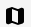.

Er verschijnt een kaartlaag met daarin alle objecten uit de verschillende objectlagen die gevalideerd zijn. Dit kunnen zijn (zie ook de legenda in de kaart voor de gebruikte iconen per objectlaag):

- Bodemvallen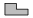
- Bruggen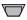
- Duikers, sifons en hevels 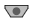
- Gemalen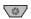
- Regelmiddelen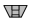
- Stuwen 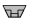
- Pompen (worden niet getoond op de kaart, maar zijn onderdeel van een ander object)
- Kunstwerkopeningen (worden niet getoond op de kaart, maar zijn onderdeel van een ander object)
- Watergangen (Hydro-objecten) :Hydroobject_HyDAMO:

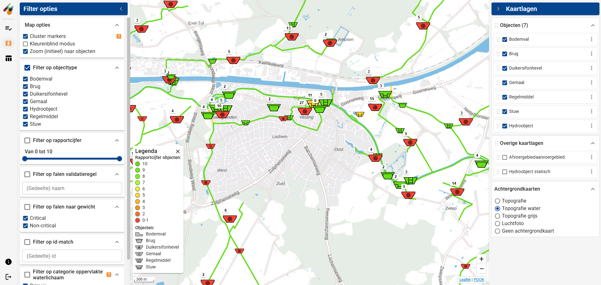

Iconen krijgen een kleur afhankelijk van het validatieresultaat. Standaard wordt een kleurverloop van rood naar groen toegepast, maar voor gebruikers die kleurenblind zijn is er ook een optie op het kleurverloop aan te passen zodat deze loopt van blauw naar rood. Deze ‘Kleurenblind modus' kan geactiveerd worden in het paneel met de filteropties (bovenin onder het item 'Map opties’).

Om de hoeveelheid iconen op de kaart overzichtelijk te houden worden iconen van hetzelfde objecttype en die dicht bij elkaar liggen geclusterd weergegeven. Met een getal boven het icoon wordt aangeduid hoeveel objecten in de cluster zitten. De kleur van het geclusterde icoon toont altijd het slechtste validatieresultaat van de individuele objecten.

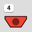

Wanneer je de muis boven een cluster-icoon plaatst, verschijnt een overzicht met aanvullende informatie: het aantal geclusterde objecten, het gemiddelde rapportcijfer en het laagste en hoogte rapportcijfer.

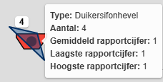

Door op een geclusterd icoon te klikken worden de individuele geclusterde iconen 'onthuld'.

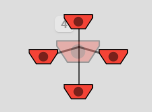

Door vervolgens de muis boven een individueel icoon te plaatsen, verschijnt een overzicht met aanvullende informatie van het betreffende object: de NEN3610id, het objecttype, het rapportcijfer en een samenvatting van het validatieresultaat.

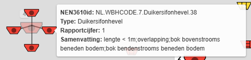

Door de kaart in te zoomen zal een cluster van objecten 'vanzelf' worden opgeheven zodra er voldoende ruimte is om deze als individuele object op de kaart te kunnen tekenen. Als objecten fysiek op dezelfde locatie liggen (bijvoorbeeld een gemaal met een regelmiddel) wordt bij elk zoomniveau een clustericoon getoond. Door op het cluster-icoon te klikken worden de individuele objecten alsnog zichtbaar.

Het is mogelijk om de clustering van objecten (iconen) uit te zetten. Dit kan door het vinkje bij ‘Cluster markers' in het paneel met de filteropties (bovenin onder het item 'Map opties’) te verwijderen. Let op: als er heel veel objecten in de databestanden zitten kan het uitzetten van de clustering ervoor zorgen dat de browser niet meer alle iconen op de kaart te tekenen, waardoor de applicatie 'vastloopt’. Zet de clustering alleen uit als de dataset beperkt is of als de kaart voldoende is ingezoomd.

Bij het valideren van objecten worden rapportcijfers toegekend. Als alle validatieregels slagen dan is het rapportcijfer gelijk aan 10. Bij het falen van een niet-kritieke validatieregel wordt het rapportcijfer verminderd met 1. Bij het falen van een kritieke validatieregel wordt het rapportcijfer verminderd met 5. Afhankelijk van het uiteindelijke beoordelingscijfer van elk object, krijgen de iconen een unieke kleur volgens onderstaande kleurverloop:

- **groen**: voor beoordelingscijfer 10
- van **geel naar oranje**: voor beoordelingscijfer 2-9
- **rood**: voor beoordelingscijfer 0-1

Door op een object te klikken open je een popup met daarin een tabel met alle validatieregels voor het betreffende object inclusief het validatieresultaat per validatieregel. Bovendien worden de berekende waarden van de parameters uit de 'general_rules' gepresenteerd.

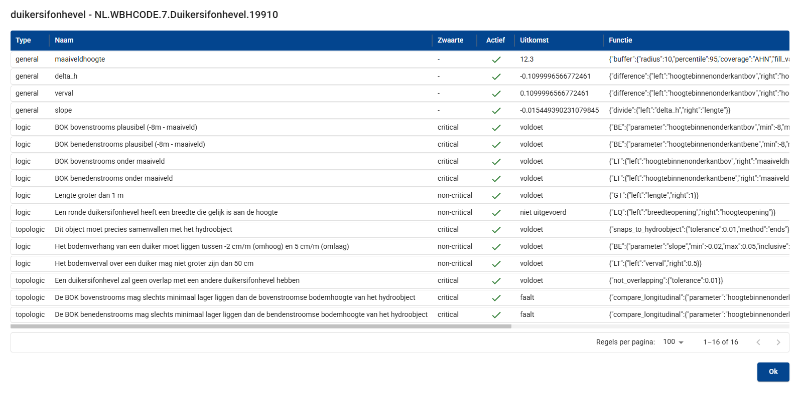

### Het paneel met filteropties

Aan de linkerzijde van het scherm zit een paneel met filteropties voor de objecten die weergegeven worden op de kaart.

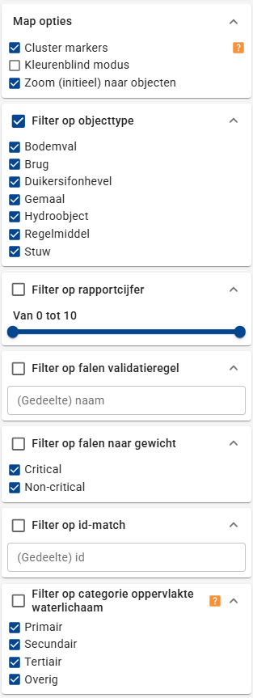{ width="180" }

### De map opties

Naast het clusteren van iconen en het activeren van een kleurenblind-modus, is er nog de optie ‘Zoom (initieel) naar objecten'. Deze optie staat standaard aan maar kan uitgezet worden door het vinkje te verwijderen. Als deze optie geactiveerd is zal de kaart bij het wisselen van schermen (bijvoorbeeld van en naar de werkruimte voor resultaten in tabellen) altijd weer uitgezoomd worden naar de extent van alle objecten. Door deze optie uit te schakelen, wordt het laatste zoomniveau van de kaart 'vastgehouden’ als er tussen werkruimtes wordt gewisseld.

### Filteren

Met name bij grotere dataset met veel objectlagen is het gebruik van de filter-opties in de kaart handig. Met filters kan je objecten op de kaart op basis van een specifiek criterium uitschakelen. Er zijn zes verschillende filtermogelijkheden beschikbaar die je met elkaar kan combineren. Elk filter is opgenomen in een inklapbare container. Met 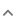 kan een item geminimaliseerd worden en met 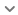 kan het item gemaximaliseerd worden zodat alle opties zichtbaar zijn.

<u>Filter op objecttype</u>

Dit filter staat automatisch aangevinkt en standaard zijn alle type objecten actief. Verwijder het vinkje bij een specifieke objectentype om de gewenste selectie uit de kaart te laten verdwijnen. In onderstaand voorbeeld worden alle duiker, sifons en hevels en bruggen getoond in de kaart (en de overige objecten niet).

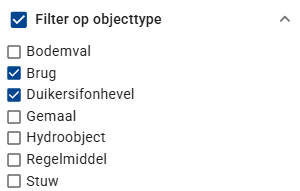{ width="280" }

<u>Filter op rapportcijfer</u>

Met dit filter kan je objecten op de kaart op basis van het rapportcijfer filteren. Plaats eerst een vinkje bij het filter om het filter actief te maken! Met de slider stel je de range van de rapportcijfers in om te reguleren wleke objecten weergegeven moeten worden. Standaard worden alle rapportcijfers weergegeven. In onderstaand voorbeeld worden alleen de objecten met een rapportcijfer van 4 tot en met 7 weergeven.

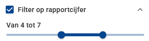{ width="280" }

*Tip: Door bijvoorbeeld dit filter te combineren met het filter op type objecten kan je alleen alle stuwen zichtbaar maken met een rapportcijfer vanaf 4 tot en met 7.*

<u>Filter op falen validatieregel</u>

Met dit filter kan je objecten op de kaart filteren die alleen gevalideerd zijn volgens een specifieke *falende* validatieregel. Plaats eerst een vinkje bij het filter om het filter actief te maken! Voer vervolgens de naam of een gedeelte uit de naam van een validatieregel in. Alleen die objecten waarvoor een validatieregel *faalt* EN waarvan (een gedeelte) van de naam overeenkomt met uw definitie, worden op de kaart getoond.

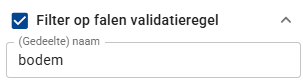{ width="280" }

<u>Filter op falen naar gewicht</u>

Met dit filter kunnen objecten op de kaart gefilterd worden die *falen* volgens niet-kritieke of kritieke validatieregels. Plaats eerst een vinkje bij het filter om het filter actief te maken! Maak een keuze tussen ‘critical' en 'non-critical’  validatieregels. Alleen die objecten worden op de kaart getoond die *falen* volgens minimaal een validatieregel van de aangevinkte voorwaarde.

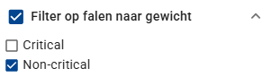{ width="280" }

*Tip: Door beide voorwaarden in dit filter aan te vinken kan je een overzicht op de kaart krijgen van alle objecten die falen. Dit is overigens ook te realiseren door het filter op rapportcijfer gelijk te kiezen aan 9 of lager.*

<u>Filter op id-match</u>

Met dit filter kan je snel een specifiek object zoeken op de kaart. Plaats eerst een vinkje bij het filter om het filter actief te maken! Vul vervolgens een (gedeelte) van de NEN3610id in om een object te filteren op de kaart.

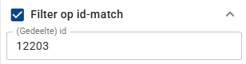{ width="280" }

<u>Filter op categorie oppervlakte waterlichaam</u>

Dit laatste filter is alleen van toepassing op de waterlopen. Plaats eerst een vinkje bij het filter om het filter actief te maken! Selecteer vervolgens de gewenste categorie van het waterlichaam (Primair, Secundair, Tertiar en Overige) dat op de kaart getoond moet worden.

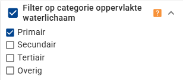{ width="280" }

### Het paneel met kaartlagen

Aan de rechterzijde van het scherm zit een paneel met de kaartlagen.

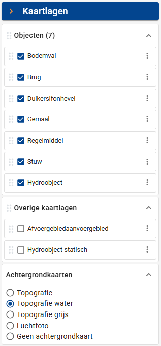{ width="180" }

<u>Kaartlagen met objecten</u>

De bovenste blok geeft de kaartlagen van de verschillende objectensoorten weer. Door een vinkje te verwijderen kan je de weergave op de kaart uitgezetten. Dit heeft overlap met het filter op objecttype! Met de zes puntjes voor een kaartlaag 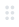 kan je een kaartlaag ‘oppakken' en naar een andere positie 'slepen’. Hiermee beïnvloedt je de opbouw van de kaartlagen in de kaart: de onderste kaartlaag wordt als eerste getekend en de bovenste als laatste.

Met de drie puntjes achter een kaartlaag open je een popup waarin onder andere de transparantie van de kaartlaag aangepast kan worden (met de slider). Met de optie 'Centreer kaartlaag' wordt de kaart in-/uitgezoomd zodat alle elementen van de betreffende kaartlaag in beeld zijn.

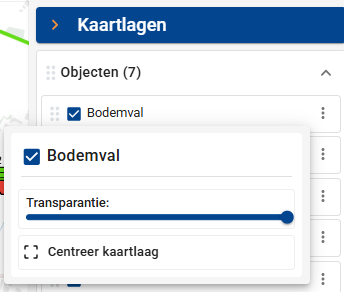{ width="280" }

<u>Overige kaartlagen</u>

Dit blok toont alle kaartlagen die wel in de datasets voorkomen maar niet gevalideerd worden omdat daarvoor geen validatieregels beschikbaar zijn. Daarnaast wordt hier - indien beschikbaar - een referentie-kaartlaag met de waterlichamen (Hydro-objecten) toegevoegd. Deze referentielaag zet je aan om bijvoorbeeld te beoordelen of sommige objecten (zoals een stuw) samenvallen met een waterlichaam.

Standaard staan de overige kaartlagen niet aan. Plaats een vinkje om deze zichtbaar te maken op de kaart. Ook voor deze kaartlagen kan je de teken-volgorde en transparantie aanpassen. Het is zelfs mogelijk om de volgorde van de overige kaartlagen met de object-kaartlagen om te wisselen. Gebruik hiervoor de drie puntjes voor de naam van het blok.

<u>Achtergrondkaartlagen</u>

Je kan vier achtergrondkaartlagen kiezen (allen afkomstig van [PDOK](https://www.pdok.nl/achtergrondkaarten1)):

- Topografie: de basisregistratie (BRT) achtergrondkaartlaag in kleur.
- Topografie water: de basisregistratie (BRT) achtergrondkaartlaag met watervlakken (standaard geselecteerd).
- Topografie grijs: de basisregistratie (BRT) achtergrondkaartlaag in grijze kleur.
- Een actuele luchtfoto (ortho).

Daarnaast is het mogelijk om de achtergrondkaartlaag uit te schakelen. Kies dan voor 'Geen achtergrondkaart'.

## 10. Bekijken van resultaten in tabelvorm

Om de validatieresultaten in tabelvorm te bekijken druk in de takentabel of in de verticale menu-balk op de icoon 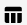.

Er verschijnt een tabel met daarin alle objecten uit de verschillende objectlagen die gevalideerd zijn. Voor elk object is weergegeven: de unieke NEN3610id, het type object, het rapportcijfer en een beknopte toelichting op de falende validatieregels.

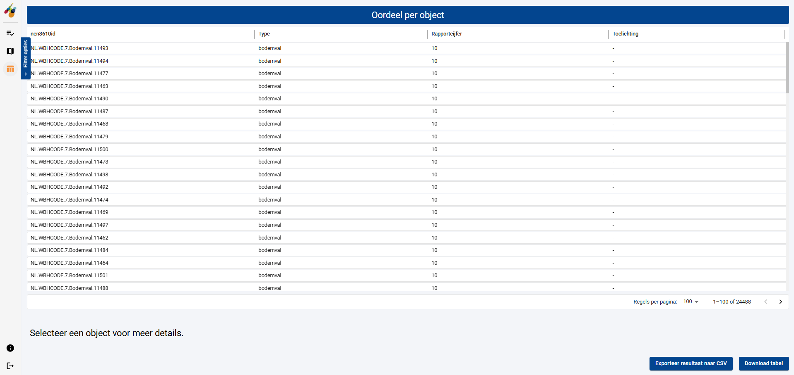

Onder de tabel kan je het aantal regels dat per pagina weergegeven moet worden aanpassen en door de verschillende pagina’s van de tabel navigeren. Ja kan de inhoud van deze tabel downloaden als CSV-bestand door de knop 'Download tabel' te gebruiken. Om meer detailinformatie over een object te verkrijgen, selecteert je een rij in de tabel. Er verschijnt een tweede tabel waarin voor het betreffende object de uitkomsten van de validatieregels.

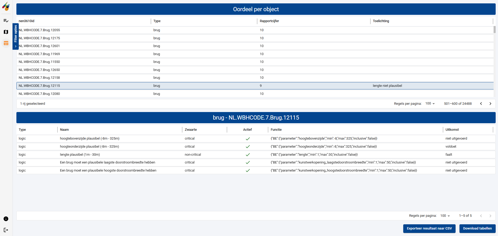

Hierin zijn voor elke validatieregel opgenomen:

- het type validatieregel.
- de naam van de validatieregel.
- het gewicht van de validatieregel (kritiek of niet-kritiek).
- of de validatieregel actief was.
- de functie van de validatieregel.
- het validatieresultaat (de uitkomst).

Wanneer beide tabellen zichtbaar zijn (objecten en validatieregels) kan je de inhoud van deze tabellen downloaden middels de knop 'Download tabellen'. Er worden dan - voor elke tabel een - twee CSV-bestanden gedownload.

Met de knop 'Exporteer resultaat naar CSV' exporteer je altijd alle informatie (voor alle objecten, ongeacht een gemaakte selectie en filter).

<u>Filters</u>

De tabel met objecten filter je op dezelfde manier als de objecten in de kaart.